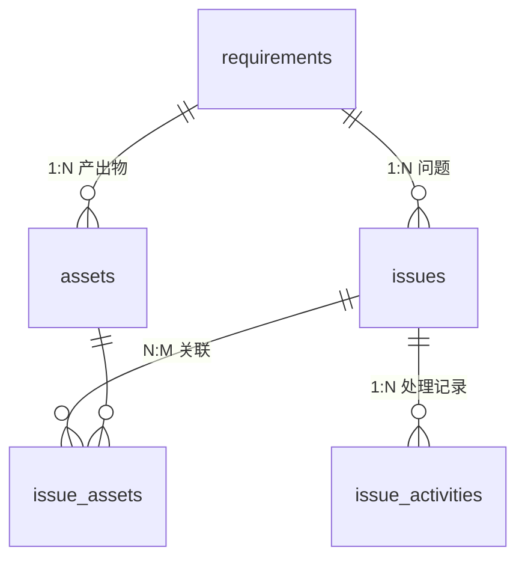

# superPM workbench 数据模型（阶段 1 定稿）

- 版本：V1.0（基于开发文档 V1.0 第 4 章 + 阶段 0 审计结论 + 已确认决策）
- 已确认决策：
  1. **扩展 `requirement_files` 演进为 Asset**，不新建第二套资源表
  2. **沿用现有阶段枚举** `analysis / design / development / testing`（列名保持 `phase`，语义 = 方案的 `step_type`）
  3. **分类合并**：`designLink` 保留；`uiIssues/devIssues/testIssues` 退役；新增方案默认分类；分类降级为纯标签
  4. **现库为测试数据**，允许随意增删改；不为此引入存量兼容层

## 1. 实体关系



命名对照：方案 `step_type` → 本库列 `phase`（值域 `analysis/design/development/testing`）；方案 `url` → 本库列 `link_url`；方案 `Asset` → 本表 `requirement_files`（表名不变，文档与 MCP 契约中称 Asset）。

## 2. assets（requirement_files 扩展后）

### 2.1 保留列（不变）

| 列 | 类型 | 说明 |
|---|---|---|
| id | INTEGER PK AUTOINCREMENT | 沿用项目主键风格 |
| requirement_id | INTEGER NOT NULL FK→requirements(id) | 所属需求 |
| phase | TEXT NOT NULL | analysis/design/development/testing（= 方案 step_type） |
| category | TEXT NOT NULL | 业务分类，纯标签，与格式/目录解耦 |
| name | TEXT NOT NULL | 展示名称 |
| link_url | TEXT NULL | 仅 link 资源（= 方案 url） |
| created_at / updated_at | TEXT NOT NULL | ISO 8601 |

### 2.2 新增列（0005 迁移）

| 列 | 类型 | 约束/默认 | 说明 |
|---|---|---|---|
| resource_type | TEXT NOT NULL DEFAULT 'file' | 'file'/'link'/'text' | 资源形态；**取代现有 kind 列的职责** |
| storage_type | TEXT NOT NULL DEFAULT 'local' | 'local'/'database'/'external' | 存储方式 |
| relative_path | TEXT NULL | — | 相对 workspace 根的路径，仅 local 文件；如 `requirements/1/files/uuid.md` |
| text_content | TEXT NULL | — | 仅 text 资源的小型文本内容 |
| mime_type | TEXT NULL | — | 创建时记录的 MIME，raw 下载优先使用 |
| description | TEXT NULL | — | 资源说明 |
| status | TEXT NOT NULL DEFAULT 'draft' | 'draft'/'final'/'archived'/'missing' | 生命周期状态 |
| is_deleted | INTEGER NOT NULL DEFAULT 0 | — | 软删除（沿用需求表风格：非空/非零即删） |

### 2.3 过渡列与退役列

| 列 | 处置 |
|---|---|
| kind | 0005 中由 `resource_type` 承接语义（file→file，link→link）；**保留列至阶段 9**，服务层切换后由清理迁移 DROP |
| is_final | 0005 中转换为 `status`（1→'final'，0→'draft'）后**保留列至阶段 9**；服务层对外继续提供只读投影 `isFinal = (status==='final')` 以兼容现有分析面板与 e2e |
| file_name | 保留：旧文件物理名（UUID 落盘在分类目录）；新文件统一落 `files/` 目录，`file_name` 继续存物理文件名，完整路径由 `relative_path` 表达 |

### 2.4 字段约束（服务层强制，SQLite 不加 CHECK 于旧表）

- `resource_type='file'` 且 `storage_type='local'`：必须有 `relative_path`；`link_url`、`text_content` 为 NULL
- `resource_type='link'`：必须有合法 `link_url`（http/https/ftp），`storage_type='external'`；`relative_path`、`text_content` 为 NULL
- `resource_type='text'`：必须有 `text_content`（≤200KB），`storage_type='database'`；`relative_path`、`link_url`、`mime_type` 为 NULL
- 不适用字段一律 NULL，不用空字符串伪装
- `category` 与扩展名/mime 无关；同一分类允许任意格式
- `status='missing'` 仅由服务层 `checkAssetAvailability` 检测文件缺失时设置，不自动删行
- 约束校验位于 Asset 服务层（阶段 3），UI 不可绕过

### 2.5 文件路径规则（分类标签化后的新规则）

- **新文件**：统一落 `{workspace}/requirements/{id}/files/{uuid.ext}`，`relative_path='requirements/{id}/files/{uuid.ext}'`
- **旧文件**：`relative_path` 惰性回填——服务层读取时若为 NULL，按旧推导规则 `requirements/{id}/{phase}/{分类中文目录}/{file_name}` 计算，访问成功后回写
- 分类不再决定物理目录；`fileCategoryFolders` 中文目录映射仅用于旧文件读取，不用于新写入

## 3. 分类定稿（stageFileCategories）

| 阶段 | 分类 key | 展示名 |
|---|---|---|
| 需求分析 | record / mind_map / flowchart / prototype / prd / other | 分析记录 / 思维导图 / 流程图 / 原型图 / PRD / 其他 |
| UI 设计 | designLink / uiAssets / design_note / prototype / other | 设计稿链接 / UI 设计文件 / 设计说明 / 原型图 / 其他 |
| 开发跟进 | discussion_record / change_note / technical_doc / other | 讨论记录 / 变更说明 / 技术文档 / 其他 |
| 需求测试 | test_report / test_data / test_evidence / other | 测试报告 / 测试数据 / 测试凭证 / 其他 |

- 退役：`uiIssues`、`devIssues`、`testIssues`——从 `stageFileCategories` 移除（测试数据可弃，无需存量可见规则）；问题职能由 Issue 体系接管
- `fileCategories` TS 枚举全集保留退役 key（避免类型破坏），`fileCategoryFolders` 保留（旧文件读取需要）
- `uiAssets` 展示名由「UI 图片」改为「UI 设计文件」；key 不变
- 新增分类默认 `single-doc` 语义取消：**仅 analysis/record 保留自动创建的分析记录**；问题记录 md 不再自动创建

## 4. issues

| 列 | 类型 | 说明 |
|---|---|---|
| id | INTEGER PK AUTOINCREMENT | |
| requirement_id | INTEGER NOT NULL FK→requirements(id) | |
| phase | TEXT NOT NULL | 仅允许 design / development / testing |
| issue_key | TEXT NULL | 展示编号（如 UI-001），第一版可空 |
| title | TEXT NOT NULL | 标题（唯一必填业务项） |
| description | TEXT NOT NULL DEFAULT '' | 问题描述 |
| issue_type | TEXT NULL | design/development/bug/change/question |
| status | TEXT NOT NULL DEFAULT 'open' | open/in_progress/resolved/closed |
| solution | TEXT NULL | 当前解决方案快照 |
| created_at / updated_at | TEXT NOT NULL | |
| resolved_at | TEXT NULL | 置 resolved 时写入；重新打开时置 NULL |
| closed_at | TEXT NULL | 置 closed 时写入 |
| is_deleted | INTEGER NOT NULL DEFAULT 0 | 软删除 |

状态机（服务层强制，事务内与 Activity 同写）：

```
open → in_progress → resolved → closed
任意状态间可流转，但：
- 置 resolved 必须携带解决说明（写入 solution）
- 置 closed 不要求 solution（关闭 ≠ 解决）
- resolved 重新打开：保留全部历史，resolved_at 清空，写 status_change 记录
```

- 不设 `priority`（方案允许按需后补）
- 需求分析阶段（analysis）不允许创建 Issue

## 5. issue_activities

| 列 | 类型 | 说明 |
|---|---|---|
| id | INTEGER PK AUTOINCREMENT | |
| issue_id | INTEGER NOT NULL FK→issues(id) | |
| activity_type | TEXT NOT NULL | comment / solution / status_change / system |
| content | TEXT NOT NULL DEFAULT '' | 处理说明或解决方案内容 |
| old_status | TEXT NULL | 仅 status_change |
| new_status | TEXT NULL | 仅 status_change |
| actor_type | TEXT NULL | user / ai / system |
| actor_name | TEXT NULL | 本地默认 'local-user'（沿用 requirement_history 现值） |
| created_at | TEXT NOT NULL | |

规则：追加式写入，禁止更新/删除历史记录；solution 变更 = 更新 issues.solution + 追加一条 solution 记录（同事务）；创建问题时写入一条 system 初始记录（统一约定，便于时间线完整）。

## 6. issue_assets

| 列 | 类型 | 说明 |
|---|---|---|
| issue_id | INTEGER NOT NULL FK→issues(id) | |
| asset_id | INTEGER NOT NULL FK→assets(id) | |
| relation_type | TEXT NOT NULL DEFAULT 'reference' | evidence / solution_material / reference / other |
| created_at | TEXT NOT NULL | |

- 主键 `PRIMARY KEY (issue_id, asset_id)`：同一问题与产出物只允许一条关联（第一版最简去重）；`relation_type` 可后续修改
- 校验（服务层）：问题与资源必须同属一个需求且均未软删除
- 删除问题/资源 → 关联行随之清理（索引行），**绝不触碰物理文件**

## 7. 索引

```sql
CREATE INDEX assets_scope_idx      ON requirement_files(requirement_id, phase, status);
CREATE INDEX issues_scope_idx      ON issues(requirement_id, phase, status);
CREATE INDEX activities_issue_idx  ON issue_activities(issue_id, created_at);
CREATE INDEX issue_assets_asset_idx ON issue_assets(asset_id);
```

（原 `requirement_files_scope_idx(requirement_id, phase, category)` 保留——按分类过滤仍是高频查询。）

## 8. 与方案字段的差异说明

| 方案 | 本实现 | 理由 |
|---|---|---|
| id TEXT/UUID | INTEGER AUTOINCREMENT | 项目既有风格（审计 3 章） |
| step_type | phase 列名不变 | 避免无意义改列；值域一致 |
| is_deleted BOOLEAN | INTEGER 0/1 | 沿用 requirements.deleted_at 同族的 SQLite 布尔风格 |
| status DATETIME 类型 | TEXT ISO | 项目统一约定 |
| priority | 不设 | 方案标注"确有需求再启用" |
| IssueAsset 多态通用关联 | 专用三列表 | 方案 4.5 建议：避免难校验的多态 |
